# Sabahattin Kalkan

**Systems engineer and software architect based in Baku.** I design software for environments where failure is expensive: building automation, life-safety and critical infrastructure, and the developer tooling around AI coding agents.

[Website](https://sabahattinkalkan.com) · [LinkedIn](https://www.linkedin.com/in/sabahattin-kalkan-b7a110b8/)

<picture>
  <source media="(prefers-color-scheme: dark)" srcset="assets/riser-dark.svg">
  
</picture>

System riser of my work, redrawn daily from live GitHub data. Revision clouds mark what changed in the latest revision.

## Focus areas

**AI developer tooling.** Repository context, diagnostics and portable rules for coding agents such as Claude Code, Codex, Cursor and Gemini CLI. Analysis is deterministic first; models interpret evidence rather than produce it.

**Building automation and infrastructure.** BMS integration over BACnet, KNX and Modbus, fire and life-safety systems, server rooms and networks, from design through field commissioning. I lead the technical department of a building-automation company.

## Selected projects

<!-- projects:start -->
| Project | Description | Type | Release | Status |
| --- | --- | --- | --- | --- |
| [Recall](https://github.com/sabahattink/Recall) | Persistent, evidence-backed repository context for coding agents. | CLI | v0.2.1 | Active |
| [codediag](https://github.com/sabahattink/codediag) | Architecture, security and reliability findings for Node.js APIs, with SARIF output. | CLI, GitHub Action | v0.4.0 | Active |
| [antigravity-fullstack-hq](https://github.com/sabahattink/antigravity-fullstack-hq) | Permission-first rules, agents and skills from one source for Claude Code, Codex and Antigravity. | Agent rules | v1.4.0 | Active |
| [reasonkit](https://github.com/sabahattink/reasonkit) | Building blocks for structured reasoning and agent orchestration. | Toolkit | v0.2.0 | Active |
| [sealed](https://github.com/sabahattink/sealed) | WebMCP privacy boundary: agents receive decisions, not raw private values. | Library | — | Active |

Generated from the GitHub API by this repository's workflow. Revision 1, 2026-10-23.
<!-- projects:end -->

## Operate the building

Building SK-01 is a simulated office floor in Baku. The outdoor temperature is real, each room follows a first-order thermal model, and alarms go through the same acknowledge cycle as a real BMS. Anyone with a GitHub account can operate it: choose a command below, submit the issue that opens, and a workflow validates the write, applies it and replies within a couple of minutes.

<picture>
  <source media="(prefers-color-scheme: dark)" srcset="assets/plan-dark.svg">
  
</picture>

<!-- building:start -->
| Zone | Temperature | Setpoint | Lights | Operate |
| --- | --- | --- | --- | --- |
| Open office | 22.4 °C | 22.0 °C | On | [−1.0 °C](https://github.com/sabahattink/sabahattink/issues/new?title=bms%3A%20office%20setpoint%2021.0&body=Submit%20this%20issue%20as%20it%20is%20to%20send%20the%20command%20to%20Building%20SK-01.%0A%0AA%20workflow%20validates%20the%20write%2C%20applies%20it%2C%20replies%20here%20with%20the%20result%20and%20closes%20the%20issue%2C%20usually%20within%20two%20minutes.%20Your%20GitHub%20username%20appears%20in%20the%20public%20operator%20log%20in%20the%20profile%20README.) · [+1.0 °C](https://github.com/sabahattink/sabahattink/issues/new?title=bms%3A%20office%20setpoint%2023.0&body=Submit%20this%20issue%20as%20it%20is%20to%20send%20the%20command%20to%20Building%20SK-01.%0A%0AA%20workflow%20validates%20the%20write%2C%20applies%20it%2C%20replies%20here%20with%20the%20result%20and%20closes%20the%20issue%2C%20usually%20within%20two%20minutes.%20Your%20GitHub%20username%20appears%20in%20the%20public%20operator%20log%20in%20the%20profile%20README.) · [Lights off](https://github.com/sabahattink/sabahattink/issues/new?title=bms%3A%20office%20lights%20off&body=Submit%20this%20issue%20as%20it%20is%20to%20send%20the%20command%20to%20Building%20SK-01.%0A%0AA%20workflow%20validates%20the%20write%2C%20applies%20it%2C%20replies%20here%20with%20the%20result%20and%20closes%20the%20issue%2C%20usually%20within%20two%20minutes.%20Your%20GitHub%20username%20appears%20in%20the%20public%20operator%20log%20in%20the%20profile%20README.) |
| Meeting room | 22.0 °C | 22.0 °C | Off | [−1.0 °C](https://github.com/sabahattink/sabahattink/issues/new?title=bms%3A%20meeting%20setpoint%2021.0&body=Submit%20this%20issue%20as%20it%20is%20to%20send%20the%20command%20to%20Building%20SK-01.%0A%0AA%20workflow%20validates%20the%20write%2C%20applies%20it%2C%20replies%20here%20with%20the%20result%20and%20closes%20the%20issue%2C%20usually%20within%20two%20minutes.%20Your%20GitHub%20username%20appears%20in%20the%20public%20operator%20log%20in%20the%20profile%20README.) · [+1.0 °C](https://github.com/sabahattink/sabahattink/issues/new?title=bms%3A%20meeting%20setpoint%2023.0&body=Submit%20this%20issue%20as%20it%20is%20to%20send%20the%20command%20to%20Building%20SK-01.%0A%0AA%20workflow%20validates%20the%20write%2C%20applies%20it%2C%20replies%20here%20with%20the%20result%20and%20closes%20the%20issue%2C%20usually%20within%20two%20minutes.%20Your%20GitHub%20username%20appears%20in%20the%20public%20operator%20log%20in%20the%20profile%20README.) · [Lights on](https://github.com/sabahattink/sabahattink/issues/new?title=bms%3A%20meeting%20lights%20on&body=Submit%20this%20issue%20as%20it%20is%20to%20send%20the%20command%20to%20Building%20SK-01.%0A%0AA%20workflow%20validates%20the%20write%2C%20applies%20it%2C%20replies%20here%20with%20the%20result%20and%20closes%20the%20issue%2C%20usually%20within%20two%20minutes.%20Your%20GitHub%20username%20appears%20in%20the%20public%20operator%20log%20in%20the%20profile%20README.) |
| Server room | 21.9 °C | 21.0 °C | Off | [−1.0 °C](https://github.com/sabahattink/sabahattink/issues/new?title=bms%3A%20server%20setpoint%2020.0&body=Submit%20this%20issue%20as%20it%20is%20to%20send%20the%20command%20to%20Building%20SK-01.%0A%0AA%20workflow%20validates%20the%20write%2C%20applies%20it%2C%20replies%20here%20with%20the%20result%20and%20closes%20the%20issue%2C%20usually%20within%20two%20minutes.%20Your%20GitHub%20username%20appears%20in%20the%20public%20operator%20log%20in%20the%20profile%20README.) · [+1.0 °C](https://github.com/sabahattink/sabahattink/issues/new?title=bms%3A%20server%20setpoint%2022.0&body=Submit%20this%20issue%20as%20it%20is%20to%20send%20the%20command%20to%20Building%20SK-01.%0A%0AA%20workflow%20validates%20the%20write%2C%20applies%20it%2C%20replies%20here%20with%20the%20result%20and%20closes%20the%20issue%2C%20usually%20within%20two%20minutes.%20Your%20GitHub%20username%20appears%20in%20the%20public%20operator%20log%20in%20the%20profile%20README.) · [Lights on](https://github.com/sabahattink/sabahattink/issues/new?title=bms%3A%20server%20lights%20on&body=Submit%20this%20issue%20as%20it%20is%20to%20send%20the%20command%20to%20Building%20SK-01.%0A%0AA%20workflow%20validates%20the%20write%2C%20applies%20it%2C%20replies%20here%20with%20the%20result%20and%20closes%20the%20issue%2C%20usually%20within%20two%20minutes.%20Your%20GitHub%20username%20appears%20in%20the%20public%20operator%20log%20in%20the%20profile%20README.) |
| Lobby | 20.8 °C | 21.0 °C | On | [−1.0 °C](https://github.com/sabahattink/sabahattink/issues/new?title=bms%3A%20lobby%20setpoint%2020.0&body=Submit%20this%20issue%20as%20it%20is%20to%20send%20the%20command%20to%20Building%20SK-01.%0A%0AA%20workflow%20validates%20the%20write%2C%20applies%20it%2C%20replies%20here%20with%20the%20result%20and%20closes%20the%20issue%2C%20usually%20within%20two%20minutes.%20Your%20GitHub%20username%20appears%20in%20the%20public%20operator%20log%20in%20the%20profile%20README.) · [+1.0 °C](https://github.com/sabahattink/sabahattink/issues/new?title=bms%3A%20lobby%20setpoint%2022.0&body=Submit%20this%20issue%20as%20it%20is%20to%20send%20the%20command%20to%20Building%20SK-01.%0A%0AA%20workflow%20validates%20the%20write%2C%20applies%20it%2C%20replies%20here%20with%20the%20result%20and%20closes%20the%20issue%2C%20usually%20within%20two%20minutes.%20Your%20GitHub%20username%20appears%20in%20the%20public%20operator%20log%20in%20the%20profile%20README.) · [Lights off](https://github.com/sabahattink/sabahattink/issues/new?title=bms%3A%20lobby%20lights%20off&body=Submit%20this%20issue%20as%20it%20is%20to%20send%20the%20command%20to%20Building%20SK-01.%0A%0AA%20workflow%20validates%20the%20write%2C%20applies%20it%2C%20replies%20here%20with%20the%20result%20and%20closes%20the%20issue%2C%20usually%20within%20two%20minutes.%20Your%20GitHub%20username%20appears%20in%20the%20public%20operator%20log%20in%20the%20profile%20README.) |

No unacknowledged alarms. Outdoor air 18.4 °C, live from Baku via [Open-Meteo](https://open-meteo.com/) (CC BY 4.0). Scanned 2026-10-23 13:00 Baku time. One command per operator every 10 minutes.

Operator log

No commands yet.

<!-- building:end -->

## Engineering principles

- **Deterministic.** The same input produces the same output, byte for byte.
- **Explainable.** Every finding traces back to a rule and a location.
- **Observable.** Structured logs, meaningful exit codes, and SARIF where it fits.
- **Local-first.** No external service in the loop unless it earns its place.

## Consulting

I'm available for building-automation integration, BMS software, and software architecture reviews. Contact details are on [sabahattinkalkan.com](https://sabahattinkalkan.com).
